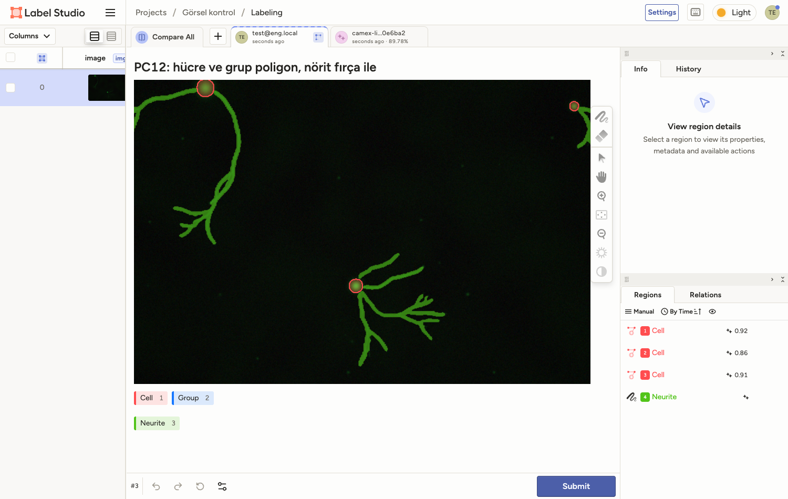

# ENG label app

PC12/mikroskop görüntülerini modelle ön etiketler, Label Studio'da insanlara kontrol ettirir ve model ile insan
etiketlerini karşılaştırır. **Web uygulaması**, mevcut **Textual TUI** ve **CLI** birlikte çalışır.

```
web: görüntü + model kartı/ağırlık yükle → yerel çalıştırıcı (sizin bilgisayarınız) → Label Studio ön etiketi
     → insan düzeltir → karşılaştırma (hücre F1/IoU, nörit/grup Dice) + maske/COCO/YOLO/JSON dışa aktarma
TUI/CLI: yerel klasör → yerel model → Label Studio → aynı karşılaştırma/dışa aktarma
```

Model **web sunucusunda çalışmaz**. Yerel çalıştırıcı sunucuya dışarı doğru HTTPS isteğiyle bağlanır (port açmaz),
görüntüyü indirir ve tahmin sonucunu gönderir. İki model ekleme yolu vardır:

- **Yalnız yerel:** Ağırlık dosyası bilgisayarınızda kalır; çalıştırıcıya `--model kart.json=/yol/model.pt` verin.
- **Web'den model yükleme:** `.json` model kartı + `.onnx`/`.pt`/`.pth` ağırlığı veri seti sayfasından yükleyin.
  Sunucuda saklanan dosya çalıştırıcı tarafından işe başlarken indirilir; **çıkarım yine bilgisayarınızda** yapılır.

`models/lite_v8.json`, örnek olarak `lite_net.pt` ağırlıklarını kullanır: smp U-Net / ConvNeXt-tiny, 7 çıktı kanalı,
Cellpose akış çözücüsü. CAMEX kaynak koduna veya paket manifestine bağlı değildir. Kaynak ağırlıklar dağıtıma **dahil
değildir**; karttaki ağırlık yolunu kendi bilgisayarınızda düzeltin ya da `--model models/lite_v8.json=/yol/lite_net.pt`
verin. Başka ONNX/smp/TorchScript modelleri ve yerel Python eklentileri için **[model kartı rehberi](models/README.md)**.

## Yerelde başlatma (Python 3.11, macOS / Linux)

```sh
uv venv --python 3.11 .venv
uv pip install --python .venv -r requirements.txt
uv venv --python 3.11 .venv-ls
uv pip install --python .venv-ls label-studio==1.23.2
scripts/start_label_studio.sh
```

Label Studio'yu ilk açışınızda hesap oluşturun. **Personal Access Token** oluşturun (Account & Settings); web
sunucusu için `LABEL_STUDIO_API_KEY` ortam değişkenine koyun. Label Studio 1.23.2'de kuruluşunuz legacy tokenları
kapattıysa Personal Access Token kullanın.

```sh
export LABEL_STUDIO_URL=http://localhost:8080
export LABEL_STUDIO_API_KEY='PERSONAL_ACCESS_TOKEN'
export ENG_ADMIN_USERNAME=admin
export ENG_ADMIN_PASSWORD='en-az-8-karakterlik-guclu-parola'
scripts/run_web.sh                 # http://127.0.0.1:8000
```

Web uygulamasına giriş yapın; bir veri seti oluşturun (Label Studio'da proje açar), görüntüleri sürükleyip bırakın.
Ekip üyeleri için giriş sonrası üst menüde **Kullanım rehberi** (`/help`) bulunur: hesaplar, yerel çalıştırıcı,
ön etiketleme, insan kontrolü, rapor ve veri güvenliği adımlarını anlatır.
Web'deki **Yerel çalıştırıcılar** sayfasından bir anahtar oluşturun; kendi bilgisayarınızda:

```sh
scripts/run_runner.sh --server http://127.0.0.1:8000 --token engr_... \
  --model models/lite_v8.json=/yol/lite_net.pt
```

Web'den yüklediğiniz modeli kullanacaksanız `--model` vermeden çalıştırıcıyı başlatabilirsiniz: varsayılan yerel model
bulunamazsa yalnızca web'den yüklenen modelleri çalıştırır. Başka bir makinede çalıştırıcı
indirmek için web arayüzündeki **Çalıştırıcıyı indir** bağlantısını kullanın; indirme paketinde ağırlık/anahtar yoktur.

**Not:** Çalıştırıcı anahtarı yalnız ilk oluşturulduğunda gösterilir; kaybederseniz yeni çalıştırıcı oluşturun.
Çalıştırıcıya iş atayın, Label Studio'da etiketleri **Submit** edin; veri seti sayfasından karşılaştırma raporu oluşturun.
Rapor sayfasında görüntü üzerinde model (eflatun) / insan (yeşil) hücre sınırları ve farklı nörit pikselleri görünür.

## Kendi sunucunuza kurulum (Docker Compose + HTTPS)

Gerekenler: Docker Compose V2, iki alan adının sunucuya DNS kaydı, açık 80/443 portları, yeterli disk (görüntüler,
modeller, PostgreSQL ve Label Studio etiketleri için). Yerel bilgisayarınızda Docker gerekmez; sunucuda çalışır.

```sh
cp .env.example .env
# .env: ENG_DOMAIN, LABEL_STUDIO_DOMAIN ve parolaları/anahtarları kendi değerlerinizle doldurun.
# POSTGRES_PASSWORD, LS_SECRET_KEY için `openssl rand -hex 32`, LS_API_KEY için `openssl rand -hex 20`.
chmod 600 .env
docker compose --profile standalone up -d --build   # yalnız 80/443 boşsa: bağımsız Caddy
docker compose ps
```

- `https://ENG_DOMAIN`: ENG web uygulaması (ilk yönetici `ENG_ADMIN_USERNAME` / `ENG_ADMIN_PASSWORD`).
- `https://LABEL_STUDIO_DOMAIN`: Label Studio (ilk yönetici `LS_ADMIN_EMAIL` / `LS_ADMIN_PASSWORD`). İki uygulamanın
  hesapları **ayrı**dır. Label Studio'da yeni kullanıcıları kuruluş davetiyle ekleyin.
- Caddy otomatik TLS sağlar; PostgreSQL yalnız Label Studio içindir. Web uygulaması kalıcı `webdata` hacminde SQLite
  tutar; Label Studio `pgdata` + `lsdata` kullanır. Hiçbir model/GPU bağımlılığı sunucu imajına kurulmaz.
- Compose, sabit `LS_API_KEY` için Label Studio **legacy token** yetkisini etkinleştirir (ilk kuruluş açılışında).
  `.env` gizli kalmalı; tokenı internete paylaşmayın. Mevcut bir Label Studio kuruluşunda legacy tokenlar kapalıysa
  `LS_API_KEY` yerine Personal Access Token üretip `LABEL_STUDIO_API_KEY` olarak web hizmetine verin; ilk kurulum
  için aynı `.env` kullanımı yeterlidir. `LABEL_STUDIO_PUBLIC_URL`, tarayıcı bağlantılarının dış alan adını gösterir.
- Yedek: sunucudaki `pgdata`, `lsdata` ve `webdata` hacimlerini **birlikte** yedekleyin; `.env` değerlerini güvenli
  yerde saklayın. Web'de veri seti silerken "Label Studio projesini de sil" seçilmezse etiketler LS'de kalır.
- Label Studio Community sürümünde proje bazlı erişim kısıtlaması yoktur: aynı kuruluştaki kullanıcılar tüm projeleri
  görebilir. Ayrı ekipler/mahremiyet gerekiyorsa ayrı Label Studio örnekleri kullanın.

**Mevcut ortak Caddy kullanan VPS (dalli-kaktus.tr):** İkinci Caddy açmayın. `docker compose -f docker-compose.yml
-f deploy/compose.vps.yml up -d --build` kullanın; ardından `deploy/eng-pc12.caddy` dosyasını
`/opt/web-gateway/config/sites/eng-pc12.caddy` konumuna koyup ortak gateway'de Caddy yapılandırmasını doğrulayın ve
yeniden yükleyin. Bu compose yalnız web ve Label Studio'yu `web-gateway` ağına bağlar; PostgreSQL iç ağda kalır.

VPS dağıtımı (ortak Caddy, HTTPS, üretim uWSGI) ve Mac'teki yerel çalıştırıcıyla sentetik görüntünün sunucu üzerinden
Label Studio'ya ön etiketlenmesi doğrulandı. Sunucuya yalnız 80/443 açın; 8000/8080/5432 dışarı verilmez.
Gerçek PC12 fotoğraflarıyla insan kontrolü ayrıca sınanmalı; yeni Docker volume'ları için harici yedek henüz yok.

## TUI ve CLI (eskisi gibi)

`config.yaml` dosyasında `model.card` (örn. `models/lite_v8.json`) ve `model.weights` (isteğe bağlı ağırlık yolu),
`label_studio.url`, `label_studio.api_key` (veya `LABEL_STUDIO_API_KEY`), `data.images` ayarlayın.

Yeni kurulumda `cp config.example.yaml config.yaml` yapın; `config.yaml` yerel yollar ve anahtar içerdiği için Git'e
girmez. `models/lite_v8.json` kartının varsayılan ağırlığı `models/lite_net.pt` (repo/model indirme paketinde yok).

```sh
scripts/run.sh                          # Textual TUI, sekmeler 1–6
.venv/bin/python -m app.cli check
.venv/bin/python -m app.cli predict --images /yol/goruntuler
.venv/bin/python -m app.cli upload
.venv/bin/python -m app.cli status
.venv/bin/python -m app.cli export --format masks coco yolo
.venv/bin/python -m app.cli evaluate
```

TUI/CLI'nin dosya yolu ve çalışma klasörü `config.yaml`'dadır; web uygulamasının veri seti/iş listesi bunlardan
**ayrıdır**. Her ikisi aynı Label Studio'ya bağlanabilir. Etiket dönüşümü ve karşılaştırma kodu ortaktır.

## Etiketler, raporlar ve sınırlar

- Hücre: model ve insan poligonları IoU ≥ 0.5 ile bire bir eşlenir; eşleşmeyen model hücresi "silinen", eşleşmeyen
  insan hücresi "eklenen", eşleşip IoU < 0.95 olan "sınırı düzeltilen" sayılır. Kesinlik, duyarlılık, F1 ve ortalama
  IoU; nörit ve grup için piksel düzeyinde Dice/IoU ve eklenen/silinen pikseller hesaplanır.
- Web raporu Markdown/JSON indirilebilir. Veri setindeki **Dışa aktar** insan etiketlerini ZIP içinde maskeler (16 bit
  hücre PNG, nörit/grup PNG), COCO, YOLO-seg (hücre ve grup; ince nöritler YOLO'ya dahil değil) ve Label Studio JSON
  olarak verir. TUI/CLI çıktıları `work/` altındadır.
- TIFF/CZI dosyası model için özgün biçimde kalır; tarayıcı/Label Studio için PNG kopyası üretilir. Çok sayfalı
  TIFF'te ilk sayfa, CZI'de ilk sahne/zaman/z kesiti kullanılır. CZI eşlemesi Zen DisplaySetting değerlerini uygular.
  16-bit TIFF/PNG görüntülemesi yüzdeliklerle 8 bite indirilir. Büyük dosyalarda sunucu disk/RAM sınırlarına dikkat.
- Lite_v8 kartındaki `frame: [1920,1080]` yalnız bu karenin tam katı fotoğrafları blok ortalamasıyla küçültür.
  Model kartının çözümleme/eşik ayarları kendi modelinizin eğitimine uygun olmalı; farklı ağın sonuçları otomatik
  olarak doğru varsayılmaz. CAMEX örneğinde sentetik 768×512 fotoğrafta 3 hücre, 10342 nörit pikseli bulundu.

## Test

```sh
.venv/bin/python -m pytest -q tests
```

12 test: maske dönüşümü, eşleştirme, rapor, kullanıcı oturumu, kullanım rehberi erişimi, yerel Python eklenti modeli ile web/çalıştırıcı uçtan
uca, web'den ONNX yükleme/çalıştırıcı indirme, iptal ve kötü anahtar. Lite_v8 ağırlığı için önceki CAMEX çıkarımının
maskeleri 768×512, 1920×1080 ve 2× fotoğrafta **piksel piksel aynı** çıktı (ONNX dışa aktarımı da aynı maskeleri
verdi). Gerçek Label Studio 1.23.2 ile PNG, 16-bit TIFF, büyük görüntü, ön etiket, insan etiketi, rapor, bindirme ve
ZIP dışa aktarma doğrulandı. Gerçek PC12 fotoğraflarıyla henüz denenmedi.


